# 📊 Awesome-Spreadsheet-Data-Tools

## 🌟 Top Spreadsheet Data Tools Ecosystem

  
  
  
  
  
  
  

**Curated List of SaaS Products & Open-Source GitHub Projects**  
*Focused on XLSX Read/Write, Formula Evaluation & Workbook Format Preservation*  
**Last updated: March 2026**

This repository tracks notable **SaaS platforms**, **commercial developer APIs**, and **open-source projects** for **Spreadsheet Data Tools**. These tools empower software engineers, data architects, and backend developers to read, write, parse, style, and manipulate Excel workbooks programmatically — from generating high-throughput financial reports and preserving complex workbook features to evaluating formulas and streaming gigabyte-scale datasets.

**Open-source emphasis**: Every major active project for self-hosting, format-preserving manipulation, and transparent formula evaluation is indexed below — ideal for developers prioritizing data sovereignty, avoiding per-developer licensing fees, and maintaining full control over spreadsheet pipelines.

Contributions welcome! Open a PR to add or update entries. Keep descriptions factual and link to official repositories.

## 📑 Table of Contents
- [🔍 SEO & Overview Summary](#-seo--overview-summary)
- [📈 Sector Overview & Market Dynamics](#-sector-overview--market-dynamics)
- [☁️ SaaS & Commercial Hosted Platforms](#️-saas--commercial-hosted-platforms)
- [🚀 Open-Source GitHub Projects (Ranked by Stars)](#-open-source-github-projects-ranked-by-stars)
- [🔬 Architectural Deep Dives & Ecosystem Recommendations](#-architectural-deep-dives--ecosystem-recommendations)
- [🤝 How to Contribute](#-how-to-contribute)
- [⚖️ Disclaimer & Engineering Insights](#️-disclaimer--engineering-insights)

---

## 🔍 SEO & Overview Summary

Welcome to the comprehensive, search-optimized index of **Spreadsheet Data Tools**, **Excel Programmatic APIs**, **Headless Formula Engines**, and **Cloud Spreadsheet Platforms**. Whether you are building an automated financial ledger, parsing millions of XLSX rows in Go or Java, embedding an interactive spreadsheet canvas in React, or ensuring that custom conditional formatting and data validations survive round-trip edits without corruption, this directory provides technical comparison data to guide your architecture.

### 🏷️ Search Keywords & Topic Tags
`spreadsheet data tools`, `excel programmatic api`, `xlsx parser`, `excel reader writer`, `formula calculation engine`, `headless spreadsheet`, `sheetjs`, `easyexcel`, `excelize`, `univer`, `handsontable`, `luckysheet`, `exceljs`, `phpspreadsheet`, `openxml sdk`, `closedxml`, `ironcalc`, `hyperformula`, `calamine`, `xlsxwriter`, `xlwings`, `format preservation`, `workbook automation`, `csv data wrangling`, `financial engineering`, `data grid`.

---

## 📈 Sector Overview & Market Dynamics

The global spreadsheet software and developer-first spreadsheet data tools market is currently valued at approximately **$13.5 billion to $18.2 billion**, projected to grow at a **CAGR of 11.8%** toward **$32+ billion** by the early 2030s, propelled by automated financial workflows, AI data pipelines, and headless workbook compilation.

The industry exhibits **moderate overall fragmentation with a bifurcated dynamic**:
- 🏢 **Front-End Productivity Suites (Concentrated Oligopoly)**: End-user GUI spreadsheets are heavily consolidated around mega-suite ecosystems like Microsoft 365 (Excel) and Google Workspace (Sheets).
- 🧩 **Programmatic Data Tools & Headless Calculation Engines (Highly Fragmented)**: The developer API, format preservation, and headless formula evaluation layer is dynamic and moderately-to-highly fragmented rather than winner-take-all. Specialized developer libraries and cloud data spreadsheets thrive across language runtimes (.NET, Java, Python, TypeScript, Rust, Go) by solving specific high-stakes requirements such as high-fidelity XML roundtripping, non-commercial self-hosting, formula AST compilation, and multi-gigabyte streaming without memory exhaustion.

---

## ☁️ SaaS & Commercial Hosted Platforms

The following commercial SaaS products, enterprise developer APIs, and cloud platforms provide programmatic Excel manipulation, formula engines, and collaborative spreadsheet data operations.

> *Sorted descending by company size (valuation / annual revenue).*

| 🏢 Platform & Provider | 💰 Company Size (Valuation / Revenue) | 💳 Starting Tier Price | 🎁 Free Tier Limit / Free Trial Plan | ✨ Core Capabilities & Highlights |
| :--- | :--- | :--- | :--- | :--- |
| **[Airtable](https://airtable.com/)**   *(Formagrid Inc.)* | **~$11.7 Billion** valuation   *($1.36B raised)* | **$20.00 / seat / mo**   *(Team plan billed annually)* | **Free Forever plan**: Unlimited bases, 1,000 records per base, 1 GB attachments, 100 automation runs/mo | Relational spreadsheet-database hybrid with programmatic REST API, automation webhooks, and interface designer. |
| **[Smartsheet](https://www.smartsheet.com/)**   *(Smartsheet Inc. / Blackstone)* | **$8.4 Billion** valuation   *(Acquired by Blackstone/Vista)* | **$9.00 / user / mo**   *(Pro plan billed annually)* | **30-day fully functional trial**; converts to **Free plan forever** for 1 user with up to 2 sheets after trial | Enterprise collaborative work management and spreadsheet workflows with automation, Gantt timelines, and REST APIs. |
| **[Coda](https://coda.io/)**   *(Coda Project Inc.)* | **~$1.4 Billion** valuation   *($140M raised)* | **$10.00 / Doc Maker / mo**   *(Pro plan billed annually)* | **Free Forever plan**: Unlimited unshared docs, up to 50 tables/views and 1,000 rows per doc | All-in-one collaborative canvas combining spreadsheets, relational docs, automated buttons, and custom formula packs. |
| **[DevExpress Office File API](https://www.devexpress.com/)**   *(Developer Express Inc.)* | **~$120M – $150M**   annual revenue | **$999.99 / dev / yr**   *(Office File API Subscription)* | **30-day fully functional free trial** with complete technical support; no credit card required | Enterprise document processing library for .NET with Excel spreadsheet creation, complex formula calculations, and PDF generation. |
| **[MESCIUS Documents for Excel](https://developer.mescius.com/document-solutions/excel-api-net)**   *(MESCIUS inc. / GrapeCity)* | **~$100M+**   annual revenue | **$1,499.00 / dev / yr**   *(Developer License)* | **30-day unrestricted trial key**; unactivated mode limits workbooks to 5 sheets, 100 rows, and watermark | High-speed server-side spreadsheet API for .NET and Java with 450+ Excel functions, sparklines, conditional formatting, and pivot tables. |
| **[Infragistics Excel Engine](https://www.infragistics.com/)**   *(Infragistics, Inc.)* | **~$90M – $120M**   annual revenue | **$1,295.00 / dev / yr**   *(Infragistics Ultimate subscription)* | **30-day fully functional free trial** without feature restrictions, includes full technical support | High-performance spreadsheet manipulation within .NET, Windows Forms, WPF, and Blazor ecosystems with native charting and filtering. |
| **[Equals](https://equals.com/)**   *(Equals Technologies, Inc.)* | **~$80M** valuation   *($22M+ Series A)* | **$29.00 / user / mo**   *(Creator plan billed annually)* | **14-day fully featured free trial** with unlimited SQL queries; free unlimited viewers forever | Next-generation cloud spreadsheet with native SQL querying, automated data warehouse sync (Snowflake, BigQuery), and BI dashboards. |
| **[Syncfusion Excel Library](https://www.syncfusion.com/excel-framework/)**   *(Syncfusion, Inc.)* | **~$70M – $90M**   annual revenue | **$395.00 / dev / mo**   *(Billed annually at $4,740 / yr for 5 devs)* | **Free Forever (Community License)** for orgs <$1M revenue & ≤5 devs; or **30-day unrestricted free trial** | Comprehensive .NET, Java, and Flutter Excel library supporting 400+ formula functions, charts, encryption, and zero server royalties. |
| **[Aspose.Cells](https://products.aspose.com/cells/)**   *(Aspose Pty Ltd / Posirion)* | **~$50M – $70M**   annual revenue | **$1,199.00** one-time perpetual   *(Small Business, 1 dev)* or **$99.00 / mo** *(Cloud API)* | **Free Evaluation forever** (adds watermark, max 100 open workbooks) or **30-day unrestricted trial license** | Standalone spreadsheet engine for .NET, Java, Python, C++ with 400+ formula functions, full formatting, and high-fidelity PDF/image export. |
| **[Row Zero](https://rowzero.io/)**   *(Row Zero, Inc.)* | **~$35M** valuation   *($10.5M raised)* | **$25.00 / user / mo**   *(Pro plan billed annually)* | **Free Forever plan**: Up to 3 workbooks, 10M cells per workbook, and connected integrations | Blazing-fast cloud spreadsheet engineered for billion-row datasets connected directly to Snowflake, Databricks, Postgres, and S3. |
| **[IronXL](https://ironsoftware.com/)**   *(Iron Software LLC)* | **~$20M – $30M**   annual revenue | **$749.00** one-time perpetual   *(Lite license, 1 dev)* | **30-day deployment trial key**; evaluation mode without key limits read/write to first 25 rows with watermark | Intuitive .NET spreadsheet library without Office Interop dependencies; reads, writes, and edits XLSX, XLS, CSV, and TSV files. |
| **[SpreadsheetGear](https://www.spreadsheetgear.com/)**   *(SpreadsheetGear LLC)* | **~$15M – $25M**   annual revenue | **$1,199.00** perpetual   *(.NET Standard single dev)* | **Free evaluation forever** limited to 1,000 rows × 100 cols × 10 sheets × 3 workbooks; **30-day unrestricted trial key** | Ultra-fast royalty-free .NET spreadsheet calculation and reporting engine with rich Windows Forms, WPF, and ASP.NET controls. |
| **[SheetJS Pro](https://sheetjs.com/pro)**   *(SheetJS LLC)* | **~$10M – $20M**   annual revenue | **$799.00 / yr**   *(SheetJS Pro Developer subscription)* | **Free Forever (Community edition)** for basic read/write without styling; **30-day trial** for SheetJS Pro | Commercial edition of SheetJS adding full styling preservation, conditional formatting, password protection, and custom number formats. |
| **[GemBox.Spreadsheet](https://www.gemboxsoftware.com/)**   *(GemBox Software d.o.o.)* | **~$5M – $12M**   annual revenue | **$790.00** one-time perpetual   *(1 developer license)* | **Free mode forever** limited to 150 rows per sheet and 5 sheets per workbook; **30-day unrestricted trial key** on request | Fast, lightweight .NET spreadsheet component with support for XLSX, XLS, ODS, CSV, HTML, and high-fidelity PDF conversion. |
| **[EPPlus](https://www.epplussoftware.com/)**   *(EPPlus Software AB)* | **~$5M – $10M**   annual revenue | **$749.00 / dev / yr**   *(Commercial Small Business license)* | **Free Forever** under PolyForm Noncommercial license for personal/non-profit use; **30-day commercial trial** | Robust, high-performance .NET library for creating and styling complex XLSX workbooks with rich chart, formula, and pivot table support. |

---

## 🚀 Open-Source GitHub Projects (Ranked by Stars)

The following open-source libraries, headless engines, and interactive web spreadsheet components power programmatic spreadsheet reading, writing, styling, and formula evaluation.

> *Sorted descending by exact GitHub stargazer count.*

| 🏆 Rank | 📦 Project & Repository | ⭐ GitHub Stars (Live Badge) | 💻 Primary Language | 🎯 Core Focus & Architecture |
| :---: | :--- | :---: | :--- | :--- |
| **1** | [**SheetJS (xlsx)**](https://github.com/SheetJS/sheetjs) |  | JavaScript / TypeScript | The most downloaded spreadsheet data parser in the JS ecosystem; reads/writes XLSX, XLS, CSV, ODS with high parsing speed. |
| **2** | [**EasyExcel**](https://github.com/alibaba/easyexcel) |  | Java | Alibaba's high-throughput, low-memory Excel engine; streams millions of rows without OutOfMemoryError via disk buffering. |
| **3** | [**Univer**](https://github.com/dream-num/univer) |  | TypeScript | Full-stack collaborative office framework featuring canvas-rendered spreadsheets, real-time collaboration, formulas, and plugins. |
| **4** | [**Handsontable**](https://github.com/handsontable/handsontable) |  | JavaScript / TypeScript | Enterprise data grid component with Excel-like UX, formula support, cell virtualization, sorting, filtering, and CRUD operations. |
| **5** | [**Excelize**](https://github.com/xuri/excelize) |  | Go (Golang) | Premier pure Go library for reading and writing Microsoft Excel (XLAM / XLSM / XLSX / XLTM / XLTX) with charts, styles, and streaming. |
| **6** | [**Luckysheet**](https://github.com/mengshukeji/Luckysheet) |  | JavaScript | Pure front-end online spreadsheet component with rich formatting, 300+ Excel formulas, pivot tables, and conditional formatting. |
| **7** | [**ExcelJS**](https://github.com/exceljs/exceljs) |  | JavaScript / Node.js | Popular Node.js & browser workbook generator; reads/writes XLSX and CSV with styles, images, data validations, and streaming I/O. |
| **8** | [**x-spreadsheet**](https://github.com/myliang/x-spreadsheet) |  | JavaScript | Lightweight canvas-based web spreadsheet widget with zero dependencies, rich formula bar, and custom cell formatting. |
| **9** | [**PhpSpreadsheet**](https://github.com/PHPOffice/PhpSpreadsheet) |  | PHP | Pure PHP library that reads and writes spreadsheet files across XLSX, XLS, ODS, and CSV formats with full calculation engine. |
| **10** | [**csvkit**](https://github.com/wireservice/csvkit) |  | Python / CLI | Suite of command-line tools for converting, cleaning, querying (SQL), and formatting tabular data from Excel, CSV, and JSON. |
| **11** | [**tealeg/xlsx**](https://github.com/tealeg/xlsx) |  | Go (Golang) | Lightweight, idiomatic Go library for reading and writing Excel XLSX files with support for sheets, cells, styles, and rows. |
| **12** | [**ClosedXML**](https://github.com/ClosedXML/ClosedXML) |  | C# / .NET | Fluent .NET library built on OpenXML that makes reading, writing, and formatting Excel XLSX workbooks simple and developer-friendly. |
| **13** | [**Open-XML-SDK**](https://github.com/OfficeDev/Open-XML-SDK) |  | C# / .NET | Official Microsoft open-source SDK for strongly typed manipulation of Open XML documents (Word, Excel, PowerPoint). |
| **14** | [**ExcelDataReader**](https://github.com/ExcelDataReader/ExcelDataReader) |  | C# / .NET | Blazing-fast, lightweight C# library for reading Excel files (XLS, XLSX, XLSB) into standard .NET `DataSet` and `DataTable` objects. |
| **15** | [**IronCalc**](https://github.com/ironcalc/IronCalc) |  | Rust / WASM | Modern, embeddable spreadsheet engine implemented in Rust; compiles to WebAssembly with unified bindings for Python, JS, and Rust. |
| **16** | [**XlsxWriter**](https://github.com/jmcnamara/XlsxWriter) |  | Python | Extremely feature-rich Python module for writing 100% compliant Excel XLSX files with native charts, sparklines, and conditional formatting. |
| **17** | [**qsv**](https://github.com/dathere/qsv) |  | Rust / CLI | Ultra-fast data-wrangling CLI toolkit for indexing, slicing, transforming, joining, and analyzing large CSV and Excel files. |
| **18** | [**FortuneSheet**](https://github.com/ruilisi/fortune-sheet) |  | TypeScript / React | Drop-in React spreadsheet component fork of Luckysheet designed for seamless React ecosystem integration and customization. |
| **19** | [**xlwings**](https://github.com/xlwings/xlwings) |  | Python | Bidirectional Python-Excel automation library; replaces VBA macros with Python scripts, custom UDFs, and Pandas/NumPy integration. |
| **20** | [**HyperFormula**](https://github.com/handsontable/hyperformula) |  | TypeScript | High-speed headless formula calculation engine with dependency graphs, AST compilation, and 380+ built-in spreadsheet functions. |
| **21** | [**calamine**](https://github.com/tafia/calamine) |  | Rust | Pure Rust library for reading Excel (XLS, XLSX, XLSB) and OpenDocument (ODS) spreadsheets with zero unsafe code and minimal memory usage. |
| **22** | [**Apache POI**](https://github.com/apache/poi) |  | Java | The foundational Java API library for reading, creating, and modifying Microsoft Office documents, including HSSF (XLS) and XSSF (XLSX). |
| **23** | [**fast-csv**](https://github.com/C2FO/fast-csv) |  | TypeScript / Node.js | Stream-based CSV parser and formatter for Node.js capable of transforming millions of rows with minimal memory footprint. |
| **24** | [**xlsx-populate**](https://github.com/dtjohnson/xlsx-populate) |  | JavaScript / Node.js | The format-preservation champion: edits existing workbooks while preserving exact XML nodes, data validation rules, drawings, and styles. |
| **25** | [**FastExcel**](https://github.com/dhatim/fastexcel) |  | Java | Lightweight, ultra-fast streaming alternative to Apache POI for reading and generating large XLSX workbooks with minimal memory usage. |
| **26** | [**readxl**](https://github.com/tidyverse/readxl) |  | C++ / R | Tidyverse library for importing tabular data from Excel (.xls and .xlsx) into R data frames with zero external Java dependencies. |
| **27** | [**Formula.js**](https://github.com/handsontable/formula.js) |  | JavaScript | Comprehensive JavaScript implementation of Microsoft Excel formula functions for web apps and calculation engines. |
| **28** | [**@bilig/headless**](https://github.com/proompteng/bilig) |  | TypeScript / Node.js | TypeScript WorkPaper runtime for backend microservices and AI coding agents to verify spreadsheet formulas, mutations, and roundtrips. |

---

### 🔬 Architectural Deep Dives & Ecosystem Recommendations

- **[SheetJS (xlsx)](https://github.com/SheetJS/sheetjs)**  `JavaScript / TypeScript`  
  **The ubiquitous standard for parsing and data conversion.** Downloaded over 2 million times weekly on npm. Excellent for ingesting heterogeneous spreadsheet files or generating basic CSV/XLSX exports.  
  *Trade-off*: The free community version strips complex cell styling, conditional formatting, and data validation rules upon write.

- **[EasyExcel](https://github.com/alibaba/easyexcel)**  `Java`  
  **High-concurrency streaming for big enterprise data.** Solves Apache POI's historical high memory consumption by rewriting the XML parser to read and write rows one by one, reducing memory usage from hundreds of megabytes to under 16MB for 1M+ rows.

- **[Excelize](https://github.com/xuri/excelize)**  `Go`  
  **The premier choice for Go microservices and backend pipelines.** Fully supports XLAM, XLSM, XLSX, XLTM, and XLTX with streaming reads and writes, complex cell styling, formula calculations, image insertion, charts, and pivot tables.

- **[Univer](https://github.com/dream-num/univer)**  `TypeScript`  
  **Next-generation collaborative document & spreadsheet framework.** Features an ultra-responsive canvas-based rendering engine, real-time multi-user operational transformation (OT/CRDT), formula parsing, and an extensible plugin system.

- **[Handsontable](https://github.com/handsontable/handsontable)**  `JavaScript / TypeScript`  
  **The benchmark web spreadsheet data grid.** Delivers an Excel-like experience inside web applications with fast virtualized scrolling, formula evaluation (via HyperFormula integration), context menus, and validation rules.

- **[ClosedXML](https://github.com/ClosedXML/ClosedXML)**  `C# / .NET`  
  **The go-to open-source .NET Excel library.** Built on top of Microsoft Open-XML-SDK, providing a clean object-oriented API that avoids boilerplate OpenXML DOM code while producing clean, standardized XLSX files.

- **[xlsx-populate](https://github.com/dtjohnson/xlsx-populate)**  `JavaScript / Node.js`  
  **The format-preservation champion for read/modify/write workflows.** Retains all existing XML structure, data validations, dropdown menus, cell comments, and drawings without stripping or duplicating rules.

- **[IronCalc](https://github.com/ironcalc/IronCalc)**  `Rust / WASM / Python / JS`  
  **Multi-language embeddable calculation engine.** Brings high-performance spreadsheet formulas to WebAssembly in browsers, Node.js runtimes, Python scripts, and native Rust applications with complete deterministic evaluation.

- **[HyperFormula](https://github.com/handsontable/hyperformula)**  `TypeScript`  
  **Headless formula evaluation powerhouse.** Fast, headless calculation engine supporting 380+ built-in Excel functions, circular reference resolution, custom function registration, and undo/redo history trees.

- **[xlwings](https://github.com/xlwings/xlwings)**  `Python`  
  **The Python-to-Excel bridge.** Ideal for automating financial workbooks, running Pandas data frames directly into spreadsheets, and replacing legacy VBA macros with modern Python code.

---

## 🤝 How to Contribute

Contributions are warmly welcomed! Help keep this directory current, accurate, and valuable for engineers worldwide:

1. 🍴 **Fork the Repository** on GitHub.
2. 🌿 **Create a Feature Branch** (`git checkout -b feature/add-tool-or-saas`).
3. 📝 **Update [README.md](README.md)** with factual descriptions, documentation links, pricing tiers, and star count rankings.
4. 🔍 **Verify Formatting**: Ensure tables remain sorted appropriately (SaaS by company valuation/revenue, Open-Source by GitHub stargazer count).
5. 🚀 **Submit a Pull Request** with a concise explanation of your additions or amendments.

---

## ⚖️ Disclaimer & Engineering Insights

- 📌 **Community Curated**: This is an independent, community-curated research collection and does not constitute an endorsement of any commercial platform or library. Software pricing, feature tiers, and API limits are subject to change by respective vendors.
- 🧪 **Format Preservation & Formula Calculation Testing**: Spreadsheet data tools differ fundamentally in XML parsing architectures. Independent testing has shown that `xlsx-populate` preserves complex data validations, drawings, and cross-sheet dropdowns during edits, while `SheetJS` community edition strips validations and styles, and `ExcelJS` can duplicate rules on multi-range reads.
- ⚙️ **Production Recommendation**: Always benchmark candidate libraries against your exact workbook specifications (e.g., conditional formatting, formula dependency depth, memory constraints during streaming) before production rollout.

---

  <b>Built with ❤️ for software engineers, data architects, and spreadsheet platform builders worldwide.</b>

